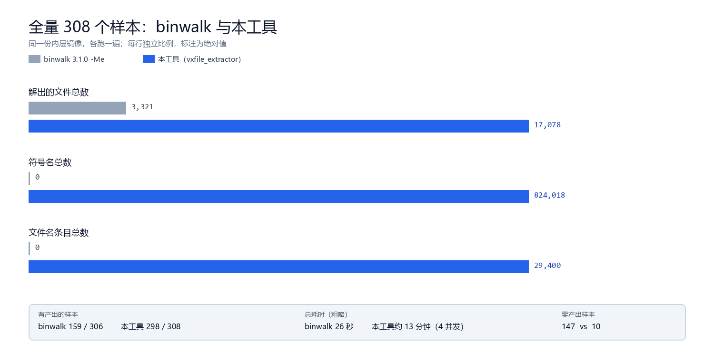

# 和 binwalk 的对照

同一份内层镜像，`binwalk 3.1.0 -Me` 与本工具各跑一遍，全量 306 个样本（308 个里 2 个是 RAR 伪装成 zip，脚本取不到内层，跳过）。

| 参数 | binwalk | 本工具 |
|---|---:|---:|
| 有产出的样本 | 159 / 306 | 298 / 308 |
| 解出的文件总数 | 3,321 | 17,078 |
| 符号表样本 | 0 | 116 |
| 符号名总数 | 0 | 824,018 |
| 文件名表样本 | 0 | 209 |
| 文件名条目总数 | 0 | 29,400 |
| 名字+内容都对上 | 0 | 704 个文件 |
| 总耗时 | 26 秒 | 约 13 分钟（4 并发） |

复现：`bash tools/compare_binwalk.sh`，逐样本数据在 `binwalk_compare.csv`。

## 怎么读这张表

1. **binwalk 在 147 个样本上一个文件都没解出来**（147/306）。
   这些基本是它认不出容器的：Netgear `.chk` 是 58 字节头加裸 LZMA1，没有 magic；
   TP-Link 的壳要到 0x94 才开始；泰克、Anritsu 直接是裸内核。

2. **符号表和文件名表 binwalk 完全不产出**，这两栏是 0 不是因为它做得差，是它本来就不做这件事。

3. **Linksys 那 10 个样本是 binwalk 赢的**：每版都是 180 多条独立 gzip 流，它一条条都解，
   文件数普遍比本工具多一倍（例如 WRT54Gv5v6：202 vs 89）。

4. **本工具慢**：全量 13 分钟对 26 秒。慢在递归解压和符号表扫描，不是 I/O。

## 一句话

binwalk 是「先看有什么」，本工具是「把东西拿出来，还要名字」。
日常还是先 `binwalk -Me` 扫一眼，认不出容器、或者要符号表和文件名的时候再上这个。
