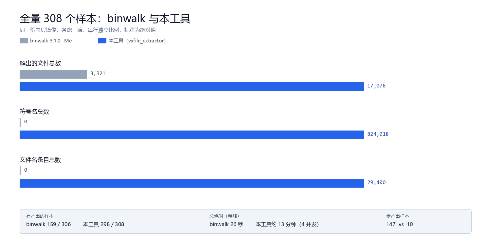

# VxWorks 固件解包：语料 + 工具

v3.0.0

给 [0xba1100n/vxfile_extractor](https://github.com/0xba1100n/vxfile_extractor) 攒的测试语料，顺手把里面能自动化的部分做成了工具。

## 为什么搞这个

手里 VxWorks 固件太少，改一行代码只能拿四五个样本验，很容易改好一个弄坏一片。
所以先攒样本，再拿样本反推工具哪里不行。

现在 **308 个已确认样本 / 148 个型号 / 11 家厂商**，每个都有来源 URL、sha256 和判定依据（`CORPUS.csv`）。

## 三个指标（Rust 引擎，308 样本）

| 指标 | 命中 | 比例 |
|---|---:|---:|
| 解包（所解容器覆盖率 ≥90%） | 209 | 67.9% |
| 重命名（恢复原始文件名） | 164 | 53.2% |
| 符号表导出 | 103 | 33.4% |

另有 75 个样本「覆盖率 <50% 且高熵 >50%」，判定为疑似加密/未识别容器。

逐固件结果在 `RUST_METRICS.csv`，汇总在 [docs/DELIVERY.md](docs/DELIVERY.md)。

## 输出长什么样

跑完屏幕上会直接告诉你东西在哪：

```
[+] Filesystem unpacked (MINIFS, layer 0x158910): 297 files
[+] Filename table (vxtable/minifs-pool): 297 entries -> MINIFS_Table.csv
[+] Output layout
    bin/   8 file(s)  <- executable / firmware image candidates
    src/   285 file(s)  <- static resources (js 166, html 81, css 13, json 9, xml 6)
    cfg/   4 file(s)  <- certificates / configs
[*] Likely main logic: kernel image layer @0x158910 (3947396 B)
    main HTTP/CGI code lives inside this image, not as a separate file
```

`bin/` 放可执行体和固件镜像候选，`src/` 放网页/脚本/样式/图片，`cfg/` 放证书和配置，都是硬链接，不多占空间。

完整说明（目录结构、分类规则、`SUMMARY.json` 字段、常见问题）在 **[docs/OUTPUT.md](docs/OUTPUT.md)**。

## 和 binwalk 比

全量 308 个样本，`binwalk 3.1.0 -Me` 与本工具各跑一遍：

| 参数 | binwalk | 本工具 |
|---|---:|---:|
| 有产出的样本 | 159 / 306 | **298 / 308** |
| 解出的文件总数 | 3,321 | **30,690** |
| 符号名总数 | 0 | **824,018** |
| 总耗时 | 26 秒 | 约 13 分钟（4 并发） |



完整表在 [BINWALK_COMPARE.md](BINWALK_COMPARE.md)，逐样本在 `binwalk_compare.csv`，复现：

```bash
bash tools/compare_binwalk.sh
```

几句实话：binwalk 在 147 个样本上一个文件都没解出来，基本是它认不出容器（`.chk`、TP-Link 的壳、裸内核）；
符号表和文件名表它本来就不做；Linksys 那批反过来是它赢，因为一版固件里有 180 多条独立 gzip 流，它一条条都解。

## 逐偏移画像

仿 binwalk，但落成可机读的表：

```bash
vx profile fw.bin --block 1024 --ascii   # 单样本：每块熵 + 类型 + 合并区间
vx profile-batch . -o PROFILE.csv        # 全量：按类型统计字节占比（13 秒）
vx entropy . -o ENTROPY.csv              # 全量：高熵区间 [start,end)（10 秒）
```

输出示例：

```
0x00156000-0x00156400       1024 B  ent  4.95  minifs
0x00158C00-0x0027E800    1203200 B  ent  7.81  high-entropy
[!] high-entropy 0x00040000-0x00141000 (1028 KiB, 99.4%) -> likely encrypted / unknown container
```

细节在 [docs/PROFILE.md](docs/PROFILE.md)。

## 摸清的四种文件系统

| 变体 | 代表 | 结构 |
|---|---|---|
| MINIFS v1 | Mercury MW/MR | `[size][offset][name:0x50]`，每文件一条 LZMA 流，offset 相对首个 `5A 00 00 80` |
| MINIFS v3 | Archer C80/C64 | 32 字节头 + ToN/ToF/ToC 三表 + chunk 级 LZMA，配置字 `5D 00 00 80` |
| MINIFS v2 | MAC1200RE | 32 字节头 + `[hash16][压缩长][name_off][解压长][0]` 与流交替，名字已哈希 |
| OW | MR900 | LZMA 流内 32 字节 `OW` 魔数 + 76 字节记录（`name[60]+0+size+offset+0`） |
| PK11 | Netgear CHK | `PK11` + `[name\0][u32 LE size]`，数据顺序排列 |

带 hexdump 和推导过程的版本：[docs/structures.md](docs/structures.md)；
哪些类别试过但解不开：[docs/UNSOLVED.md](docs/UNSOLVED.md)。

## 怎么用

Python（需要 binwalk）：

```bash
python tools/verdict.py fw.bin            # 先确认是不是 VxWorks
python tools/vxfile_extractor/vxfile_extracter.py fw.bin
python tools/run_extractor.py --limit 5   # 批量跑，结果进 runs/
python tools/capability_report.py         # 生成 CAPABILITY.md
```

Rust（不需要 Python、不需要 binwalk）：

```bash
vx extract fw.bin -o out/
vx scan fw.bin
vx tables fw.bin
vx symbols fw.bin
```

## 解不开的

- **Belkin 7 个样本**：层里几百个 `.htm` 全是 MIME 类型和调试字符串，没有已知文件系统魔数。
- **TP-Link 老机型 / MR904**：升级包里只有内核和一张名字清单，`<html`、`PNG`、`GIF8` 出现次数都是 0，文件数据在设备另一个 flash 分区。
- **TRENDnet `*_nml.bin`**：786,432 字节，8 字节头 + 约 590 KB 密文（熵 7.96），无 ECB 重复块，68 个候选密钥的 AES 全败，密钥在 bootloader 里。
- **泰克 TDS210 / THS**：裸内核，没有文件系统，解不出文件属正常。

## 关于符号表

`SYMBOL_Table` 是**符号名串**，没有地址。想要「函数名 → 地址」，得另去定位 VxWorks 的 `symTbl` 结构，目前没做。
符号名的用途：grep 函数名确认库在不在、判断版本、给反汇编器做函数名提示。

## TODO

- 符号表补上地址映射
- MiniFS v2 的名字（现在只能按内容编号）
- TRENDnet `*_nml.bin` 的解密（缺密钥，除非拿到设备）

## 目录

```
tools/            判定、解包、统计、对照脚本
rust/vxcore/      Rust 版引擎，编译成单文件
docs/             OUTPUT.md、结构说明、流水线图
CORPUS.csv        308 条样本的来源和 sha256
CAPABILITY.md     三项能力统计（自动生成）
dist/             已编译的产物
```

## 致谢

样本和格式认识基本都来自 0xba1100n 的 vxfile_extractor 和那篇[看雪帖](https://bbs.kanxue.com/thread-284324.htm)，
MINIFS 分块结构参考了 [RedaOps/minifs-extractor](https://github.com/RedaOps/minifs-extractor) 与 winmt 师傅的[论文](https://arxiv.org/html/2407.05064v1)。

有错误欢迎拍砖，觉得有用就给个 ⭐。
