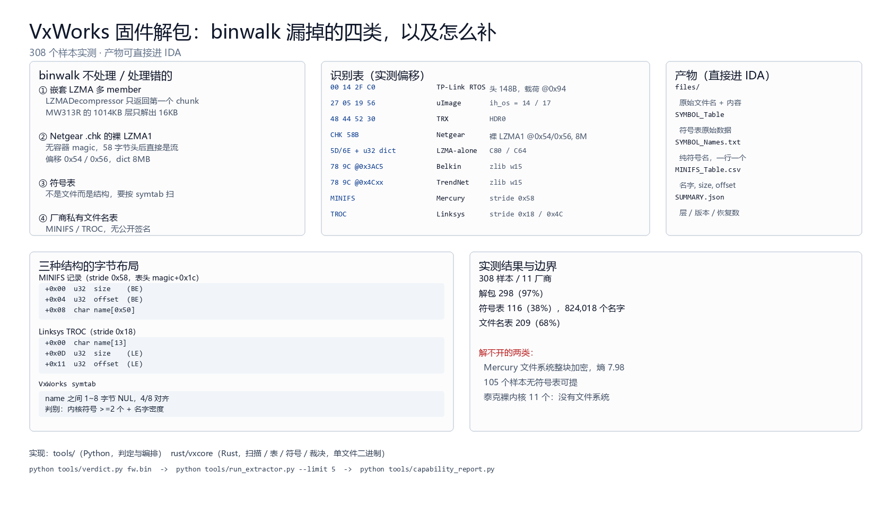

# VxWorks 固件解包：binwalk 漏掉的四类，以及怎么补

308 个样本实测，产物直接进 IDA。

## 1. binwalk 不处理或处理错的

| 情况 | 现象 | 为什么 |
|---|---|---|
| 嵌套 LZMA 多 member | MW313R 的 1014KB 层只解出 16KB | `LZMADecompressor` 只返回第一个 chunk，后续 member 在 `unused_data` 里 |
| Netgear `.chk` 裸 LZMA1 | 没有容器 magic，扫不出 | 58 字节头后直接是 LZMA1 流，偏移 0x54 / 0x56，dict 8MB |
| 符号表 | 不提取 | 不是文件，是结构；要按 VxWorks symtab 扫（名字 NUL 分隔、4/8 对齐） |
| 厂商私有文件名表 | 不认 | MINIFS / TROC 无公开签名 |

## 2. 识别表（实测偏移）

| 魔数 / 特征 | 格式 | 关键位置 |
|---|---|---|
| `00 14 2F C0` | TP-Link RTOS 壳 | 头 148 字节，载荷 @0x94 |
| `27 05 19 56` | uImage | `ih_os = 14`（VxWorks）/ 17 |
| `48 44 52 30` | TRX | HDR0 |
| CHK 58 字节头 | Netgear | 裸 LZMA1 @0x54 / 0x56，dict 8MB |
| props `5D` / `6E` + u32 dict | LZMA-alone | TP-Link C80 / C64 |
| `78 9C` @0x3AC5 | Belkin | zlib，wbits 15 |
| `78 9C` @0x4Cxx | TrendNet | zlib，wbits 15 |
| `MINIFS` | Mercury | stride 0x58 |
| `TROC` | Linksys | stride 0x18 / 0x4C |

## 3. 三种结构的字节布局

```
MINIFS 记录（stride 0x58，首条在 magic+0x1c）
+0x00  u32  size    (BE)
+0x04  u32  offset  (BE)
+0x08  char name[0x50]

Linksys TROC（stride 0x18）
+0x00  char name[13]
+0x0D  u32  size    (LE)
+0x11  u32  offset  (LE)

VxWorks symtab
name 之间 1~8 字节 NUL，4/8 字节对齐
判别：内核符号 >= 2 个 + 名字密度
```

## 4. 产物

```
out/
├─ files/            原始文件名 + 内容
├─ SYMBOL_Table      符号表原始数据
├─ SYMBOL_Names.txt  纯符号名，一行一个
├─ MINIFS_Table.csv  名字, size, offset
└─ SUMMARY.json      层 / 版本 / 恢复数
```

## 5. 实测结果与边界

- 308 样本 / 11 厂商
- 解包 298（97%）
- 符号表 116（38%），共 824,018 个名字
- 文件名表 209（68%）

解不开的两类：

- Mercury 的文件系统整块加密（熵 7.98），105 个样本无符号表可提
- 泰克裸内核 11 个，没有文件系统

## 6. 复现

```bash
vx verdict fw.bin
vx extract fw.bin -o out/
vx batch . -o stats/RUST_METRICS.csv
```

批量统计：

```bash
vx extract fw.bin -o out/
```


